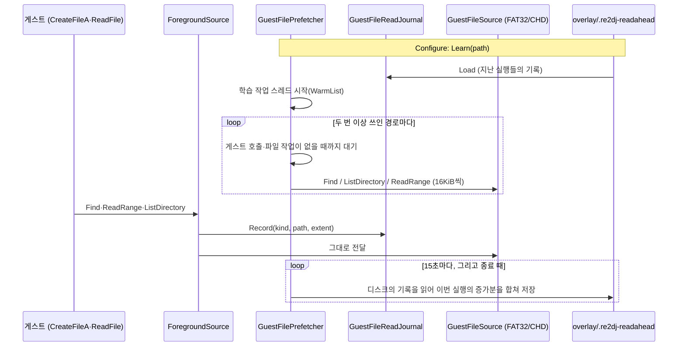

# #24 설계: 읽었던 CHD 경로를 기억해 다음 실행에서 미리 읽기

이슈: [#24](https://github.com/reexec/re2DJ/issues/24) · 앞선 작업: [#9 설계](20261009-i009-chd-file-prefetch.md)

## 배경

#9로 곡 재생 중의 멈춤은 사라졌지만, CHD가 HDD에 있으면 캐시 없는 곡 로딩이 여전히 1.1~2.9초 멈춥니다. 6th의 어트랙트 데모로 잰 결과는 다음과 같습니다(측정 방법과 수치는 [작업 로그](../work-logs/20261012-i024-learned-chd-read-ahead.md)).

* 한 곡의 로딩은 파일 약 410개를 읽고, 게스트의 source 호출이 I/O로 약 1.8초를 기다립니다. 처음 읽는 hunk마다 HDD 탐색이 하나씩 붙기 때문입니다.
* 그중 **곡마다 다른 것**은 `BG/<곡>`(약 400ms)와 `SOUND/<곡>`(약 200ms)뿐입니다. 나머지 약 1.25초는 모드의 패널(`System/<모드>/Panel`), `RubyMix/Panel`, `InGameEffector`, `ranking`, 그리고 처음 보는 디렉터리 항목 조회(`SOUND` 목록 하나에 179ms)로, 어느 곡을 고르든 같습니다.
* 폴더를 통째로 미리 읽는 방법은 효과가 없었습니다. 패널·랭킹 폴더는 CHD 안에서 27~47조각으로 흩어진 13~23MB인데, 게임은 그중 일부만 읽습니다. 곡 폴더처럼 거의 한 덩어리인 폴더만 골라 읽어도, HDD에서 게임의 읽기와 겹쳐 로딩 시간이 측정 편차(약 ±0.2초) 안에서 바뀌지 않았습니다.
* 공통 부분을 어트랙트 중에 미리 읽어 둔 실험에서는 첫 곡 로딩이 약 2.1초에서 약 1.0초로 줄었습니다.

곡과 무관한 공통 부분은 그 게임이 그 사용자에게서 **늘 읽는 것**입니다. 그러니 게스트가 읽은 경로를 기억해 두면, 다음 실행은 게스트가 묻기 전에 읽어 둘 수 있습니다.

## 목표

* 게스트의 source 호출(경로 조회, 디렉터리 목록, 파일 읽기)을 실행이 끝나도 남는 기록(`GuestFileReadJournal`)에 모읍니다.
* 다음 실행은 **두 번 이상 쓰인** 경로를 작업 스레드에서 미리 읽어 host 캐시에 올립니다. 게스트 호출이 진행 중이면 기다립니다.
* Windows·Linux 공용입니다(`src/hle/`). OS 캐시에 올리는 것이므로 host 쪽 코드는 필요 없습니다.

## 구조

* `hle::GuestFileReadJournal`(`include/re2dj/hle/guest_file_read_journal.h`, `src/hle/guest_file_read_journal.cpp`): 순수 로직이며 잠금이 없습니다.
  * 항목은 종류(`f` 조회, `l` 목록, `r` 읽기), 경로, 읽은 범위의 끝(`extent`), 사용 횟수(`uses`)입니다. 키는 종류와 대문자 경로입니다.
  * **사용 횟수**: 한 실행에서 처음 쓸 때 1, 그리고 `kUseGap`(10초) 넘게 쓰이지 않다가 다시 쓰일 때마다 1을 더합니다. 한 곡의 로딩은 몇 초 안에 끝나고 다음 곡은 수십 초 뒤이므로, 곡마다 공통으로 읽는 파일은 한 실행 안에서도 곡 수만큼 셉니다. 곡 하나에만 쓰이는 파일은 그 곡을 다시 고를 때만 늘어납니다.
  * `WarmList(budget)`: `uses ≥ 2`인 항목을 많이 쓰인 순서로 읽기 바이트 합이 예산(64MiB) 안일 때까지 고르고, **기록 순서**(게스트가 처음 쓴 순서)로 돌려줍니다. 그래서 로고·타이틀처럼 먼저 쓰이는 것이 먼저 읽힙니다.
  * 저장 형식은 한 줄에 `uses<TAB>kind<TAB>extent<TAB>path`인 텍스트입니다. 읽을 수 없는 줄은 버립니다. 항목은 8,192개까지입니다.
  * `MergeInto(target)`: 마지막 `MarkSaved` 뒤 늘어난 사용 횟수, 더 긴 `extent`, 새 항목을 `target`에 더합니다. 6th는 부트스트랩(`EZ2DJ.EXE`)과 게임(`EZ2DJ6th.EXE`)이 **동시에** 같은 overlay를 쓰므로, 저장은 늘 디스크의 현재 기록에 합치는 방식입니다. 그렇지 않으면 나중에 끝나는 부트스트랩이 게임의 기록을 덮어씁니다.
* `GuestFilePrefetcher`
  * `Learn(path)`: 기록을 읽고 학습 작업 스레드를 띄웁니다. 스레드는 `WarmList`를 차례로 읽습니다(파일은 16KiB 조각). 조각마다 게스트의 source 호출이 없고(`foreground_ == 0`) #9의 파일 작업이 쉬고 있을 때(`!busy_`)까지 기다립니다. HDD가 한 번에 한 흐름만 읽게 하려는 것입니다.
  * 다 읽은 뒤에는 15초마다(`kJournalSaveInterval`) 바뀐 것이 있으면 저장하고, 소멸자에서 한 번 더 저장합니다. 게임이 `ExitProcess`로 끝나거나 프로세스가 강제로 끝나면 소멸자가 불리지 않을 수 있기 때문입니다. 저장은 `.tmp`에 쓴 뒤 이름을 바꿉니다. overlay 디렉터리가 아직 없으면(게스트가 아무것도 쓰지 않은 실행) 저장하지 않습니다.
  * `Record(kind, path, extent)`: 별도 잠금(`journal_lock_`) 아래에서 기록합니다.
* `GuestFiles`: `ForegroundSource`가 게스트의 `Find`·`ReadRange`·`ListDirectory`를 기록에 남깁니다. 학습 스레드의 읽기는 내부 source로 바로 가므로 기록되지 않습니다. #9의 파일 미리 읽기가 메모리에서 돌려주는 읽기도 source를 거치지 않으므로 기록되지 않습니다. `Configure`가 overlay 루트의 `.re2dj-readahead`로 `Learn`을 부릅니다.

## 하지 않는 것

* **폴더 통째 미리 읽기**는 넣지 않습니다. 실험 결과는 작업 로그에 남깁니다. 그 실험의 CHD 위치 계산(두 번째 libchdr handle)도 넣지 않습니다. #9 설계대로 handle마다 hunk map 메모리가 크기 때문입니다.
* 첫 실행과, 처음 고르는 곡의 곡 전용 파일(BG·키음)은 빨라지지 않습니다.
* 오래 쓰지 않은 항목을 줄여 가는 감쇠는 하지 않습니다. 예산 64MiB와 8,192개 상한이 크기를 묶습니다.
* hunk 캐시 크기(32MB)는 바꾸지 않습니다. 미리 읽은 것은 주로 OS 캐시에 남습니다.

## 검증

1. 단위 테스트
   * `guest_file_read_journal_test.cpp`: 사용 횟수(간격 안의 반복은 한 번, 간격 뒤 다시), 대소문자 무시, 종류별 항목, 저장·읽기 왕복과 잘못된 줄 버리기, `WarmList`의 기준·예산·순서, `MergeInto`가 증가분만 더하고 `MarkSaved` 뒤에는 더하지 않음, 항목 상한.
   * `guest_file_prefetcher_test.cpp`: overlay에 둔 기록에서 두 번 쓰인 경로만 미리 읽고, 게스트의 읽기가 기록되어 실행 끝에 파일로 합쳐짐.
2. Windows x86 Debug·Release 빌드와 CTest, WSL Linux x64·x86·clang 빌드와 CTest(경고를 오류로).
3. 실제 실행(Windows Release, CHD가 HDD): Windows 파일 캐시와 드라이브 캐시를 비운 뒤 6th 어트랙트 데모의 곡 로딩 시간을 잽니다. 기록이 없는 실행, 한 실행 분 기록, 두 실행 분 기록을 비교합니다. 측정할 때만 임시 계측을 얹습니다.

---

# #24 Design: Remembering the CHD Paths Read and Reading Them Ahead in Later Runs

Issue: [#24](https://github.com/reexec/re2DJ/issues/24) · Earlier work: [#9 design](20261009-i009-chd-file-prefetch.md)

## Background

#9 removed the stalls during a song, but with the CHD on an HDD a cold song load still stalls 1.1 to 2.9 s. Measured on 6th's attract demo (method and numbers in the [work log](../work-logs/20261012-i024-learned-chd-read-ahead.md)):

* One song load reads about 410 files, and the guest's source calls wait about 1.8 s on I/O, each hunk read for the first time adding an HDD seek.
* Of that, only `BG/<song>` (about 400 ms) and `SOUND/<song>` (about 200 ms) **differ per song**. The other 1.25 s or so is the mode's panels (`System/<mode>/Panel`), `RubyMix/Panel`, `InGameEffector`, `ranking`, and first lookups of directory entries (179 ms for the `SOUND` listing alone), the same whichever song is picked.
* Reading whole directories ahead did not help. The panel and ranking directories are 13 to 23 MB scattered over 27 to 47 pieces of the CHD, of which the game reads a part. Reading only the nearly contiguous directories, such as a song's, overlapped the game's own reads on the HDD and left the load time within the measuring noise (about ±0.2 s).
* An experiment reading the common part ahead during the attract mode cut the first song load from about 2.1 s to about 1.0 s.

The common part is what the game **always reads** for this user. Remembering the paths the guest read lets the next run read them before the guest asks.

## Goals

* Collect the guest's source calls (path lookups, directory listings, file reads) in a record that outlives the run (`GuestFileReadJournal`).
* The next run reads the paths **used more than once** into the host's cache on a worker thread, waiting while a guest call is under way.
* Shared by Windows and Linux (`src/hle/`); it fills the OS cache, so no host code is needed.

## Structure

The sequence diagram above: `Configure` calls `Learn(path)`, which loads the journal left by earlier runs and starts the learning worker; the worker reads each path used at least twice (lookups, listings, and reads in 16 KiB pieces), each piece only once no guest call and no file job is under way; the guest's calls go through `ForegroundSource`, which records them and passes them on; every 15 s and at the end the worker merges this run's gains into the journal as it is on disk.

* `hle::GuestFileReadJournal` (`include/re2dj/hle/guest_file_read_journal.h`, `src/hle/guest_file_read_journal.cpp`): pure logic, no locking.
  * An entry is a kind (`f` lookup, `l` listing, `r` read), a path, how far a read reached (`extent`) and a use count (`uses`), keyed by kind and upper-cased path.
  * **Uses**: 1 the first time in a run, and 1 more each time it is used again after `kUseGap` (10 s) without it. A song loads within seconds and the next comes tens of seconds later, so a file every song reads counts once per song even within one run, while a file only one song reads grows only when that song is picked again.
  * `WarmList(budget)`: the entries with `uses ≥ 2`, the most used first while their reads fit the budget (64 MiB), given back **in journal order** (the order the guest first used them), so what comes first, such as the logo and title, is read first.
  * The file is text, one `uses<TAB>kind<TAB>extent<TAB>path` per line; lines that do not parse are dropped; at most 8,192 entries.
  * `MergeInto(target)`: adds the uses gained since the last `MarkSaved`, longer extents and new entries to `target`. 6th's bootstrap (`EZ2DJ.EXE`) and game (`EZ2DJ6th.EXE`) use the same overlay **at the same time**, so a save always merges into the journal as it is on disk; otherwise the bootstrap, ending later, would overwrite the game's record.
* `GuestFilePrefetcher`
  * `Learn(path)`: loads the journal and starts the learning worker, which reads the `WarmList` in turn (files in 16 KiB pieces), each piece only once no guest source call is under way (`foreground_ == 0`) and #9's file worker is idle (`!busy_`), so the HDD serves one stream at a time.
  * Afterwards it saves every 15 s (`kJournalSaveInterval`) when something changed, and once more in the destructor, since a game ending through `ExitProcess` or a killed process may skip destructors. A save writes `.tmp` and renames it, and is skipped while the overlay directory does not exist yet (a run in which the guest wrote nothing).
  * `Record(kind, path, extent)` records under a lock of its own (`journal_lock_`).
* `GuestFiles`: `ForegroundSource` records the guest's `Find`, `ReadRange` and `ListDirectory`. The learning worker's reads go to the inner source and are not recorded, nor are the reads #9's prefetch serves from memory, which do not reach the source. `Configure` calls `Learn` with `.re2dj-readahead` at the overlay root.

## Out of scope

* **Reading whole directories ahead** is left out, with the experiments recorded in the work log, and so is that experiment's way of locating hunks in the CHD (a second libchdr handle): as #9's design notes, each handle costs a large hunk map.
* The first run, and the song-only files (BG, key sounds) of a song picked for the first time, are not sped up.
* No decay of entries unused for long; the 64 MiB budget and the 8,192-entry limit bound it.
* The hunk cache size (32 MB) stays; what is read ahead mostly stays in the OS cache.

## Verification

1. Unit tests
   * `guest_file_read_journal_test.cpp`: use counting (repeats within the gap count once, again after it), case-insensitivity, per-kind entries, the save/load round trip dropping bad lines, `WarmList`'s threshold, budget and order, `MergeInto` adding only the gains and nothing after `MarkSaved`, and the entry limit.
   * `guest_file_prefetcher_test.cpp`: from a journal in the overlay only the paths used twice are read ahead, and the guest's reads are recorded and merged into the file at the end of the run.
2. Windows x86 Debug and Release builds with CTest, and WSL Linux x64, x86 and clang builds with CTest (warnings as errors).
3. A real run (Windows Release, CHD on the HDD): with the Windows file cache and the drive's cache emptied, time the song loads of 6th's attract demo with no journal, a journal of one run and one of two runs, with temporary instrumentation added only for measuring.
