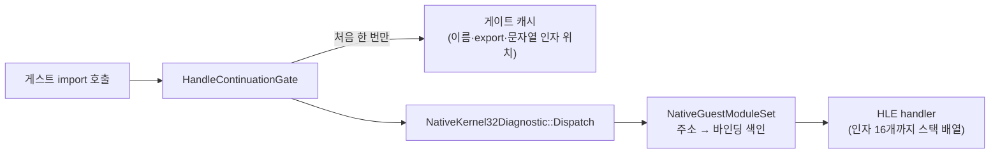

# #25 설계: in-process 러너의 import 경로와 DirectDraw Clear 비용 줄이기, `--vsync` 옵션

이슈: [#25](https://github.com/reexec/re2DJ/issues/25) · 배경: [Windows in-process 러너 성능](../analysis/windows-in-process-performance.md)

## 배경

TODO "in-process 러너 성능 분석"은 vsync를 끈 처리량 저하(주입 방식 대비 −11~−22%)의 원인을 import 경로와 전역 게스트 잠금으로 추정했지만 확인하지 않았습니다. 측정에 쓸 vsync off는 임시 패치로만 있었습니다. 바깥에서 게스트 프로세스의 스레드를 주기적으로 멈춰 스택을 보는 샘플링 프로파일(4th, vsync off, RelWithDebInfo)에서 게스트 메인 스레드의 CPU가 다음에 쓰였습니다.

* import마다 관측 경로(`HandleContinuationGate`)가 게이트 이름을 문자열로 조립하고(`GateName`·`FormatGate`), export를 레지스트리에서 **이름으로** 다시 찾았습니다(`FindFacadeExport` → `GuestModuleRegistry::FindExport` → 모듈 이름 정규화 `NormalizeModuleName`·`AsciiLower`). 이것만 샘플의 약 30%였습니다.
* 게이트를 주소로 찾는 곳(`NativeGuestModuleSet::FindGate`, `Dispatch`)은 바인딩 목록 전체를 선형 탐색했고, 한 import에서 세 번 일어났습니다.
* `Dispatch`가 인자마다 `std::vector`를 할당했고, 호출 기록(`OriginalApiCall`, 문자열 세 개)이 기록 목록에 복사됐습니다.
* DirectDraw `Clear`(`FillSurface`)는 프레임마다 화면 크기(640×480×2 = 614KB) 버퍼를 0으로 할당하고, 바이트 단위로 채운 뒤, 게스트 메모리로 복사했습니다. 샘플의 약 25%였습니다.

## 바꾸는 것

* `NativeGuestModuleSet`: 게이트 주소 → 바인딩 색인(`binding_index_`). `FindGate(address)`와 `Dispatch`가 이것을 씁니다. 새 `FindExport(address)`는 바인딩의 export descriptor를 돌려줍니다. 인자는 16개까지 스택 배열에 담습니다.
* `NativeKernel32Diagnostic::FindFacadeExport`: 레지스트리를 이름으로 찾지 않고 `FindExport(address)`를 씁니다. 반환형은 `GuestExportDescriptor*`입니다(호출처는 이름과 인자 수만 읽음).
* 관측 경로: 게이트 주소마다 이름, export, 문자열 인자 위치를 처음 볼 때 한 번 계산해 캐시합니다. 게이트는 실행 중에 바뀌지 않습니다. 호출 기록은 마지막에 move로 목록에 넣습니다.
* `FillSurface`: 16비트 값으로 한 번에 채운 버퍼를 씁니다. host는 모두 x86이라 메모리 바이트 순서가 게스트와 같습니다.
* `--vsync on|off|adaptive`: `PresentSync`(`kVerticalSync`·`kImmediate`·`kAdaptive`)로 옮겨 SDL host의 창 설정에 넘깁니다. 기본값은 on으로 그대로입니다. 자식 실행은 명령줄을 물려받으므로 6th의 게임 프로세스에도 적용됩니다.

동작(어떤 import가 어떻게 처리되는지, API 로그의 내용)은 바뀌지 않습니다.

## 하지 않는 것

* 전역 게스트 잠금의 넘겨주기 방식, private bytes, 6th working set은 이 작업에서 다루지 않습니다(TODO에 남김).
* 프로파일러는 저장소에 넣지 않습니다(측정 도구, 방법은 작업 로그).

## 검증

1. 기존 단위 테스트(import dispatcher·module 테스트가 같은 경로를 씀)와 CTest, Windows x86 Debug·Release, WSL Linux x64·x86·clang 빌드.
2. 실제 실행: 바꾸기 전·후 Release를 다섯 타깃에서 vsync off로 번갈아 40초씩 두 번 돌려 처리량을 비교합니다. 기본 설정(vsync on)에서 4th·6th가 경고 없이 60fps인지 봅니다.

---

# #25 Design: Cutting the In-Process Runner's Import Path and DirectDraw Clear Costs, and a `--vsync` Option

Issue: [#25](https://github.com/reexec/re2DJ/issues/25) · Background: [Windows in-process runner performance](../analysis/windows-in-process-performance.md)

## Background

The TODO "in-process runner performance analysis" put the vsync-off throughput loss (−11 to −22% against injection) down to the import path and the global guest lock without confirming it, and vsync off for measuring existed only as a temporary patch. A sampling profile taken from outside, suspending the guest process's threads in turn and walking their stacks (4th, vsync off, RelWithDebInfo), showed the guest main thread's CPU going to:

* for every import, the observation path (`HandleContinuationGate`) building the gate's name as a string (`GateName`, `FormatGate`) and looking the export up again **by name** in the registry (`FindFacadeExport` → `GuestModuleRegistry::FindExport` → module-name normalization in `NormalizeModuleName` and `AsciiLower`), about 30% of the samples by itself;
* the lookups of a gate by address (`NativeGuestModuleSet::FindGate`, `Dispatch`) scanning every binding linearly, three times per import;
* `Dispatch` allocating a `std::vector` for the arguments, and the call record (`OriginalApiCall`, three strings) being copied into the record lists;
* DirectDraw `Clear` (`FillSurface`) allocating a zeroed screen-sized buffer (640×480×2 = 614 KB) every frame, filling it a byte at a time and copying it into guest memory, about 25% of the samples.

## Changes

The flowchart above: the guest's import reaches `HandleContinuationGate`, which works a gate out once into a cache (name, export, string-argument positions), then `NativeKernel32Diagnostic::Dispatch` and `NativeGuestModuleSet`'s address-to-binding index lead to the HLE handler with up to 16 arguments in a stack array.

* `NativeGuestModuleSet`: a gate-address-to-binding index (`binding_index_`) used by `FindGate(address)` and `Dispatch`; a new `FindExport(address)` returns the binding's export descriptor; up to 16 arguments go in a stack array.
* `NativeKernel32Diagnostic::FindFacadeExport` uses `FindExport(address)` instead of a by-name registry lookup and returns a `GuestExportDescriptor*` (its caller reads only the name and argument count).
* The observation path works out each gate address's name, export and string-argument positions once and caches them, gates not changing during a run, and moves the call record into the lists at the end.
* `FillSurface` writes a buffer filled with the 16-bit value in one pass; every host is x86, so the bytes in memory are in the guest's order.
* `--vsync on|off|adaptive` maps to `PresentSync` (`kVerticalSync`, `kImmediate`, `kAdaptive`) and goes to the SDL host's window configuration; the default stays on. Child runs inherit the command line, so 6th's game process gets it too.

Behaviour (how each import is handled, what the API log says) is unchanged.

## Out of scope

* The global guest lock's hand-over, private bytes and 6th's working set stay in the TODO.
* The profiler stays out of the repository (a measuring tool; the method is in the work log).

## Verification

1. The existing unit tests (the import dispatcher and module tests use the same path) and CTest; Windows x86 Debug and Release, WSL Linux x64, x86 and clang builds.
2. Real runs: the Release builds before and after alternate, 40 s each, twice, on five targets with vsync off to compare throughput; at the default (vsync on) 4th and 6th run at 60 fps without warnings.
