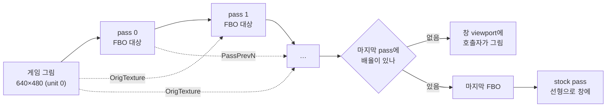

# #27 설계: 다단계 화면 셰이더(`.glslp`)와 `fsr` RCAS·`scalefx`·`anime4k`

이슈: [#27](https://github.com/reexec/re2DJ/issues/27) · 앞선 작업: [#26 설계](20261025-i026-fsr-screen-shader.md), [작업 455 설계](20261005-455-post-process-shaders.md)

## 배경

작업 455의 후처리 파이프라인은 한 파일, 한 pass를 창에 바로 그립니다. FSR 1의 둘째 단계(RCAS 선명화)는 EASU의 출력을 다시 읽어야 하고, ScaleFX는 다섯 pass가 경계 정보를 주고받으며, Anime4K는 작은 신경망의 층마다 pass 하나와 부동소수점 중간 결과가 필요합니다. 셋 다 libretro preset(`.glslp`)으로 표현되는 구조라, 그 형식의 부분집합을 받으면 외부 셰이더도 가져올 수 있습니다.

## 구조

* `graphics/post_shader_preset.h`(`src/graphics/post_shader_preset.cpp`, GL 없음): `PostShaderPass`(경로·텍스트·배율 방식·배율·필터·float·`to_window`), `ParsePostShaderPreset`(`shaders`, `shaderN`, `scale_typeN`/`_x`/`_y`, `scaleN`/`_x`/`_y`, `filter_linearN`, `float_framebufferN`; 읽기는 호출자가 넘긴 reader), `SinglePassPreset`, `PostShaderPassSize`. 배율이 없는 마지막 pass는 창에 바로 그립니다(`to_window`).
* 카탈로그: 내장이 파일 하나가 아니라 **포함된 파일 묶음**(`kPostShaderBuiltinFiles`, 이름과 텍스트)과 시작 파일(`crt.glsl`, `fsr/fsr.glslp` …)이 됩니다. CMake가 목록의 파일을 읽어 12000바이트 조각의 raw 문자열로 넣습니다(MSVC의 리터럴 한도). `LoadPostShaderText`는 `LoadPostShaderPreset`으로 바뀌어 preset의 상대 경로를 내장 묶음이나 preset 옆 파일에서 읽습니다. 디렉터리 목록에 `.glslp`도 들어갑니다.
* `OpenGlPostProcess`: pass마다 프로그램·uniform 위치·FBO 대상(`RGBA8` 또는 `RGBA16F`, 크기가 바뀌면 다시 만듦). `UseForPresent`가 게임 텍스처와 창 viewport를 받아 마지막 전까지의 pass를 직접 그리고(단위 사각형, 자기 정점 배열), 마지막 pass의 프로그램을 current로 두고 창 viewport를 되돌린 채 돌아옵니다. 호출자(backend)는 전처럼 사각형 하나를 그립니다. 마지막 pass에 배율이 있으면 내장 stock pass(선형 복사)가 그 역할을 합니다. 텍스처 unit: 0 `Texture`, 1 `OrigTexture`, 2부터 `PassPrevN`. `OrigTexture`의 필터는 첫 pass의 것입니다. 매개변수는 체인이 이름으로 공유합니다(먼저 선언한 pass의 범위). FBO 진입점이 없는 GL에서는 다단계 셰이더를 거절하고 단일 pass는 전처럼 됩니다.
* 내장 preset
  * `fsr/`: `easu.glsl`(#26의 것, `scale_type viewport 1.0`, nearest) → `rcas.glsl`(창에, `FSR_SHARPNESS` 스톱). RCAS는 `ffx_fsr1.h`의 알고리즘을 옮긴 것입니다.
  * `scalefx/`: libretro glsl-shaders의 다섯 pass 파일을 **그대로**(MIT), preset은 같은 값으로 다시 써서 pass를 옆 파일로 가리킵니다. 네 pass는 1배(앞 둘은 float), 마지막은 3배. 셰이더는 `#version 130`이며 2.1 호환 context에서 컴파일됩니다(NVIDIA 확인).
  * `anime4k/`: bloc97의 `Anime4K_Upscale_CNN_x2_S.glsl`(mpv 훅 다섯 개)을 변환했습니다. 네 합성곱 층은 1배 float, 마지막 depth-to-space는 2배로 `OrigTexture`(선형)에 luma 세부를 더합니다. mpv의 y는 아래로, 우리 텍스처의 y는 위로 커서 오프셋의 y와 사분면 선택을 뒤집었습니다. 가중치는 원본 그대로입니다.
* 도움말, README, 가이드(업스케일러 표와 preset 형식), THIRD_PARTY_NOTICES(ScaleFX, Anime4K 행; FSR 행에 RCAS).

## 하지 않는 것

* `srgb_framebuffer`, `wrap_mode`, `mipmap_input`, `alias`, LUT 텍스처, `PrevTexture`(이전 프레임), slang.
* Anime4K의 큰 모델(M·L·VL·UL)과 Restore·Deblur 체인. S가 CPU 없는 셰이더 다섯 개로 충분히 가볍고, 큰 모델은 pass 수십 개입니다.
* 화면 전체가 아니라 그림마다 업스케일하는 것(텍스처 업로드 단계 변경).

## 검증

1. 단위 테스트 `post_shader_test.cpp`: 내장 다섯의 순서, 각 preset의 pass 수(1·1·2·5·5)와 마지막 pass의 `to_window`, 모든 pass가 파싱됨, 매개변수 유무, 빠진 디렉터리에서 내장 다섯. preset 파서 테스트: 키 읽기, 배율 방식, 오류(개수 없음·셰이더 없음·잘못된 값·읽기 실패), 단일 pass, `PostShaderPassSize`.
2. `re2dj_opengl_post_shader_probe` 12개(단일 pass 경로가 그대로임), Windows x86 Debug·Release, WSL Linux x64·x86·clang.
3. 실제 실행: 4th·6th 4K 전체 화면에서 `none`·`fsr`·`scalefx`·`anime4k`를 같은 장면으로 찍어 비교하고, vsync off 처리량으로 비용을 잽니다. 로그에 적용 줄(`post shader fsr (1 parameters)` 등).

---

# #27 Design: Multi-pass Screen Shaders (`.glslp`) with `fsr` RCAS, `scalefx` and `anime4k`

Issue: [#27](https://github.com/reexec/re2DJ/issues/27) · Earlier work: [#26 design](20261025-i026-fsr-screen-shader.md), [task 455 design](20261005-455-post-process-shaders.md)

## Background

Task 455's post-processing pipeline draws one file, one pass, straight into the window. FSR 1's second pass (RCAS sharpening) must read EASU's output again, ScaleFX's five passes hand edge data to one another, and Anime4K needs a pass per layer of its small network with floating-point results between them. All three are expressed as libretro presets (`.glslp`), so accepting a subset of that format also lets outside shaders in.

## Structure

The flowchart above: the game's picture (unit 0) goes through pass 0, 1, … each into a framebuffer target of its own, every pass able to read the picture as `OrigTexture` and earlier outputs as `PassPrevN`; a last pass with no scale is drawn into the window viewport by the caller, while a scaled last pass ends in a framebuffer that the stock pass copies to the window linearly.

* `graphics/post_shader_preset.h` (`src/graphics/post_shader_preset.cpp`, no GL): `PostShaderPass` (path, text, scale types, scales, filter, float, `to_window`), `ParsePostShaderPreset` (`shaders`, `shaderN`, `scale_typeN`/`_x`/`_y`, `scaleN`/`_x`/`_y`, `filter_linearN`, `float_framebufferN`; files come through a reader the caller passes), `SinglePassPreset`, `PostShaderPassSize`. An unscaled last pass draws into the window (`to_window`).
* The catalog: a built-in is now a **set of embedded files** (`kPostShaderBuiltinFiles`, name and text) and a main file (`crt.glsl`, `fsr/fsr.glslp`, …). CMake reads the listed files into raw string pieces of 12000 bytes (MSVC's literal limit). `LoadPostShaderText` becomes `LoadPostShaderPreset`, resolving a preset's relative paths in the embedded set or beside the preset. Directory listings include `.glslp`.
* `OpenGlPostProcess`: per pass a program, uniform locations and a framebuffer target (`RGBA8` or `RGBA16F`, remade when the size changes). `UseForPresent` takes the game's texture and the window viewport, draws every pass but the last itself (the unit square with its own vertex arrays), and returns with the last pass's program current and the window viewport restored, so the backend draws its one quad as before; a scaled last pass gets the built-in stock pass (a linear copy) for that. Texture units: 0 `Texture`, 1 `OrigTexture`, 2 onwards `PassPrevN`; `OrigTexture` takes the first pass's filter. Parameters are shared by name across the chain (the first pass to declare one gives the range). A GL without framebuffer entry points refuses multi-pass shaders and keeps single passes as before.
* Built-in presets
  * `fsr/`: `easu.glsl` (#26's, `scale_type viewport 1.0`, nearest) → `rcas.glsl` (into the window, `FSR_SHARPNESS` in stops), RCAS ported from `ffx_fsr1.h`.
  * `scalefx/`: libretro glsl-shaders' five pass files **unchanged** (MIT), with the preset written anew to the same values, naming the passes beside it: four at 1x (the first two float), the last at 3x. The shaders are `#version 130` and compile under the 2.1 compatibility context (confirmed on NVIDIA).
  * `anime4k/`: bloc97's `Anime4K_Upscale_CNN_x2_S.glsl` (five mpv hooks) converted: four convolution layers at 1x in float, and the depth-to-space step at 2x adding luma detail to `OrigTexture` (linear). mpv's y runs down and our textures' up, so the offsets' y and the quadrant choice are turned over; the weights are the original's.
* The help, README, the guide (an upscaler table and the preset format), THIRD_PARTY_NOTICES (ScaleFX and Anime4K rows; RCAS on the FSR row).

## Out of scope

* `srgb_framebuffer`, `wrap_mode`, `mipmap_input`, `alias`, lookup textures, `PrevTexture` (the previous frame), slang.
* Anime4K's larger models (M, L, VL, UL) and its Restore and Deblur chains: S is light at five passes, the large ones are dozens.
* Upscaling per picture rather than the whole screen (a texture-upload change).

## Verification

1. Unit test `post_shader_test.cpp`: the five built-ins in order, each preset's pass count (1, 1, 2, 5, 5) and its last pass's `to_window`, every pass parsing, parameters present or not, and five built-ins from a missing directory. Preset parser tests: keys, scale types, errors (no count, no shader, a bad value, a failed read), the single pass, `PostShaderPassSize`.
2. `re2dj_opengl_post_shader_probe` (12 checks; the single-pass path is unchanged), Windows x86 Debug and Release, WSL Linux x64, x86 and clang.
3. Real runs: 4th and 6th fullscreen at 4K captured under `none`, `fsr`, `scalefx` and `anime4k` on the same scene and compared, vsync-off throughput for the cost, and the applied lines in the log (`post shader fsr (1 parameters)` and the like).
