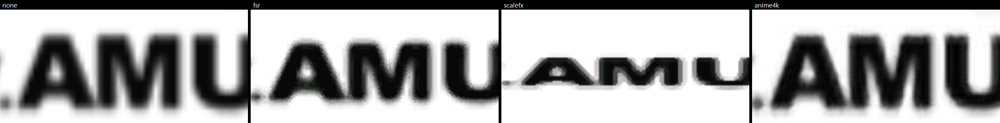
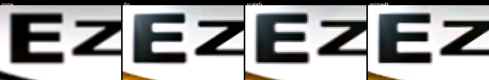

# 화면 후처리 셰이더 / Post-processing shaders

설계: [20261005-455](../design/20261005-455-post-process-shaders.md) · 작업 로그: [20261005-455](../work-logs/20261005-455-post-process-shaders.md) · 형식: [kb](../kb/libretro-glsl-post-shaders.md)

*Design: [20261005-455](../design/20261005-455-post-process-shaders.md) · work log: [20261005-455](../work-logs/20261005-455-post-process-shaders.md) · format: [kb](../kb/libretro-glsl-post-shaders.md)*

## 1. 고르는 방법 / Choosing a shader

| 방법 | 지속 | 예 |
| --- | --- | --- |
| 명령행 | 그 실행(환경 변수보다 우선) | `re2dj ez2dj4th --post-shader crt`, `re2dj --post-shader=scanline ez2dj4th` |
| 환경 변수 | 그 실행 | `RE2DJ_POST_SHADER=scanline` |
| 실행 중 백틱(`` ` ``) OSD | 그 실행만 | Screen shader 콤보, Reload, 매개변수 슬라이더 |

명령행 옵션은 `--post-shader <id>`와 `--post-shader=<id>` 두 형식이며 타깃 앞뒤 어디에 와도 됩니다. 여러 번 주면 마지막 값을 쓰고, 값이 없거나(`--post-shader`가 마지막 인자) 비어 있으면(`--post-shader=`) 사용법 오류로 exit 1입니다. `--` 뒤의 인자는 옵션으로 읽지 않습니다(작업 457, rePIU 작업 771과 같은 규칙). id는 `none`(기본), 내장 `crt`·`scanline`·`fsr`·`scalefx`·`anime4k`, 또는 `shaders/` 안의 파일 이름(`my_crt.glsl`, 다단계 `my_chain.glslp`)입니다. `shaders/`는 작업 디렉터리를 먼저 보고, 없으면 실행 파일 옆을 봅니다. 6th처럼 런처가 자식을 띄우는 타깃은 자식도 같은 셰이더로 열립니다.

*Command line (that run, over the environment variable): `re2dj ez2dj4th --post-shader crt` or `re2dj --post-shader=scanline ez2dj4th`, before or after the target, the last of a repeated option winning, a missing (`--post-shader` last) or empty (`--post-shader=`) value a usage error with exit 1, and nothing after `--` read as an option (task 457, rePIU task 771's rules); environment variable (that run): `RE2DJ_POST_SHADER=scanline`; the backtick OSD while running (that run only): the Screen shader combo, Reload, parameter sliders. Ids are `none` (the default), the built-in `crt`, `scanline`, `fsr`, `scalefx` and `anime4k`, or a file name in `shaders/` (`my_crt.glsl`, or a multi-pass `my_chain.glslp`), looked up in the working directory first and beside the executable otherwise. A target whose launcher starts a child, such as 6th, opens the child with the same shader.*

### 내장 업스케일러 / The built-in upscalers

세 내장 셰이더가 640×480을 창 크기로 키우는 방식을 바꿉니다(#26, #27). 모두 프레임 하나만 보며 확대율이 클수록 `none`(선형)과 차이가 큽니다. 2배 창에서는 차이가 작고, 4K 전체 화면(4.5배)에서 분명합니다. 4th 4K 전체 화면의 vsync off 처리량(RTX 4090, `none` 799fps 기준)을 비용으로 적었습니다.

| id | 방식 | 어울리는 그림 | 매개변수 | 비용 |
| --- | --- | --- | --- | --- |
| `fsr` | AMD FidelityFX Super Resolution 1.0: EASU가 경계 방향을 따라 창 크기로 키우고 RCAS가 선명하게 함 | 사진·CG 전반. 글자 둘레가 약간 밝아지면 선명도를 낮춤 | `FSR_SHARPNESS`(스톱, 0이 가장 강함) | 688fps |
| `scalefx` | ScaleFX(Sp00kyFox): 원본 색만 써서 계단 경계를 매끈한 선으로 바꿔 3배로 그린 뒤 창 크기로 | 픽셀아트. EZ2DJ의 CG·안티앨리어싱 글자는 윤곽이 딱딱해지고 배경이 단색화됨 | 임계값·AA·모서리 | 538fps |
| `anime4k` | Anime4K v3.2 Upscale CNN x2 (S)(bloc97): 작은 신경망이 2배에서 윤곽 세부를 더한 뒤 창 크기로 | 그림·CG. 잡티 없이 적당히 선명 | 없음 | 565fps |

*Three built-ins change how 640×480 is scaled to the window (#26, #27). All look at one frame, and the larger the scale the larger the difference from `none` (linear): small at the 2x window, clear fullscreen at 4K (4.5x). The cost column is 4th's fullscreen 4K vsync-off throughput (RTX 4090, `none` 799 fps). `fsr`, AMD FidelityFX Super Resolution 1.0, EASU scaling along edge directions to the window and RCAS sharpening it, suits photos and CG in general (lower the sharpness if lettering gains a light rim), with `FSR_SHARPNESS` in stops, 0 the strongest, at 688 fps. `scalefx`, ScaleFX by Sp00kyFox, turns stair-stepped edges into smooth lines using only the picture's own colours at 3x, then scales to the window: for pixel art, while EZ2DJ's CG and anti-aliased lettering get hard outlines and posterized backgrounds; threshold, AA and corner parameters; 538 fps. `anime4k`, Anime4K v3.2 Upscale CNN x2 (S) by bloc97, a small network adding edge detail at 2x before scaling to the window, suits drawn art and CG, moderately sharper without artifacts, no parameters, 565 fps.*





## 2. 직접 셰이더 쓰기 / Writing a shader

libretro 단일 pass GLSL 형식의 부분집합입니다. 한 파일에 두 단계를 `VERTEX`·`FRAGMENT`로 나눕니다. 내장 `src/graphics/post_shaders/scanline.glsl`이 가장 짧은 예입니다.

*A subset of libretro single-pass GLSL: one file, two stages guarded by `VERTEX` and `FRAGMENT`. The built-in `src/graphics/post_shaders/scanline.glsl` is the shortest example.*

```glsl
#pragma parameter STRENGTH "Strength" 0.5 0.0 1.0 0.05

#if defined(VERTEX)
attribute vec4 VertexCoord;
attribute vec4 TexCoord;
uniform mat4 MVPMatrix;
varying vec2 tex_coord;
void main()
{
    gl_Position = MVPMatrix * VertexCoord;
    tex_coord = TexCoord.xy;
}
#elif defined(FRAGMENT)
uniform sampler2D Texture;
uniform vec2 TextureSize;   // the game's logical resolution, e.g. 640x480
uniform vec2 OutputSize;    // the picture's pixel size in the window
varying vec2 tex_coord;
#ifdef PARAMETER_UNIFORM
uniform float STRENGTH;
#else
#define STRENGTH 0.5
#endif
void main()
{
    gl_FragColor = texture2D(Texture, tex_coord) * (1.0 - STRENGTH * 0.5);
}
#endif
```

쓸 수 있는 이름: attribute `VertexCoord`, `TexCoord`, `COLOR`; uniform `MVPMatrix`, `Texture`, `InputSize`, `TextureSize`, `OutputSize`, `FrameCount`, `FrameDirection`; `#pragma parameter`. GLSL 1.20 문법을 쓰십시오. `PrevTexture`(이전 프레임)와 LUT는 지원하지 않습니다. 다단계 preset은 아래 절을 보십시오.

작성 중에는 게임을 켠 채 파일을 고치고 OSD의 **Reload**를 누르면 됩니다. 컴파일 오류는 OSD에 빨간 글씨로 나오며, 그동안 화면은 `none`으로 그려집니다. 처음 연 셰이더가 적용되지 않으면 로그에 `presentation: post shader '…' not applied: …`가 남습니다.

*Available names: attributes `VertexCoord`, `TexCoord`, `COLOR`; uniforms `MVPMatrix`, `Texture`, `InputSize`, `TextureSize`, `OutputSize`, `FrameCount`, `FrameDirection`; `#pragma parameter`. Use GLSL 1.20; `PrevTexture` (the previous frame) and LUTs are not supported; multi-pass presets are described below. While writing, keep the game running, edit the file and press **Reload** in the OSD; a compile error shows in red in the OSD and the picture is drawn as `none` meanwhile. When the shader a window opens with is not applied, the log reads `presentation: post shader '…' not applied: …`.*

### 다단계 preset(`.glslp`) / Multi-pass presets (`.glslp`)

`shaders/` 안의 `.glslp` 파일은 여러 pass를 잇습니다(#27). libretro preset 형식의 부분집합입니다.

```ini
shaders = 2
shader0 = easu.glsl          # preset 파일 기준 상대 경로
filter_linear0 = false       # 이 pass가 Texture를 읽는 필터(기본 linear)
scale_type0 = viewport       # source(입력의 배수)·viewport(화면 그림의 배수)·absolute(픽셀)
scale0 = 1.0                 # scale_type_x0/scale_x0처럼 축마다 따로 둘 수도 있음
float_framebuffer0 = true    # 색이 아닌 값을 쓰는 pass는 부동소수점 대상으로
shader1 = rcas.glsl          # 배율이 없는 마지막 pass는 창에 바로 그림
```

각 pass는 앞 pass의 출력을 `Texture`로, 게임 그림을 `OrigTexture`로, N개 앞 pass의 출력을 `PassPrevNTexture`로 읽을 수 있고, 이름마다 `...TextureSize`·`...InputSize`가 있습니다(여기서는 모두 그 텍스처의 픽셀 크기). 마지막 pass에 배율이 있으면 그 결과를 선형으로 창에 그립니다. `#pragma parameter`는 pass들이 이름으로 공유합니다. `srgb_framebuffer`, `wrap_mode`, `mipmap_input`, `alias`, LUT 텍스처는 지원하지 않습니다. mpv 훅 형식(Anime4K 원본)이나 slang은 직접 변환해야 합니다. 내장 preset(`src/graphics/post_shaders/fsr/`, `scalefx/`, `anime4k/`)이 예입니다.

*A `.glslp` file in `shaders/` chains passes (#27), in a subset of the libretro preset format: `shaders` (the count), and per pass `shaderN` (a path relative to the preset), `filter_linearN` (how the pass samples `Texture`, linear by default), `scale_typeN` (`source`, a multiple of the input; `viewport`, of the picture in the window; `absolute`, pixels) with `scaleN` (or `_x`/`_y` each), and `float_framebufferN` for a pass writing values rather than colours; a last pass with no scale draws straight into the window. Each pass reads the one before as `Texture`, the game's picture as `OrigTexture` and the output N passes back as `PassPrevNTexture`, each with `...TextureSize` and `...InputSize` beside it (both the texture's pixel size here); a scaled last pass is drawn to the window linearly, and `#pragma parameter`s are shared by name across passes. `srgb_framebuffer`, `wrap_mode`, `mipmap_input`, `alias` and lookup textures are not supported, and mpv hook files (Anime4K's own) or slang need converting by hand. The built-in presets under `src/graphics/post_shaders/fsr/`, `scalefx/` and `anime4k/` are the examples.*

## 3. 확인 절차 / Check procedure

1. `re2dj ez2dj4th --post-shader crt`로 실행합니다. 로그에 `post shader     : crt`와 `presentation: post shader crt (6 parameters)`가 나옵니다.
2. 화면이 휘고 주사선과 마스크가 보이는지 봅니다. 주사선은 기본 2배 창 이상에서 뚜렷합니다.
3. 백틱 → Screen shader에서 `scanline`, `none`으로 바꿔 즉시 바뀌는지 봅니다. `none`이면 후처리 없는 원래 화면입니다.
4. `shaders/test.glsl`에 위 예제를 넣고 Reload → 목록에 `test.glsl`이 나오고 고를 수 있는지 봅니다. 파일에 일부러 오타를 넣고 Reload하면 오류가 보이고 화면은 `none`이어야 합니다.
5. `RE2DJ_POST_SHADER=scanline`을 두고 `--post-shader` 없이 실행하면 scanline으로, `--post-shader none`을 더하면 `none`으로 열리는지 봅니다.
6. 자동 확인: `re2dj_opengl_post_shader_probe`(데스크톱에서 직접 실행)가 12개 항목을 모두 `PASS`로 끝내야 합니다.

*Run `re2dj ez2dj4th --post-shader crt` (the log shows `post shader     : crt` and `presentation: post shader crt (6 parameters)`); check the curvature, scanlines and mask, clear at the default 2x window or more; switch to `scanline` and `none` from the backtick OSD and check the change is immediate; put the example in `shaders/test.glsl`, press Reload and choose `test.glsl`, then break it on purpose and check the error and the `none` picture; with `RE2DJ_POST_SHADER=scanline` a run without `--post-shader` opens with scanline and one with `--post-shader none` with none; and `re2dj_opengl_post_shader_probe`, run by hand on a desktop, ends with all 12 checks `PASS`.*
